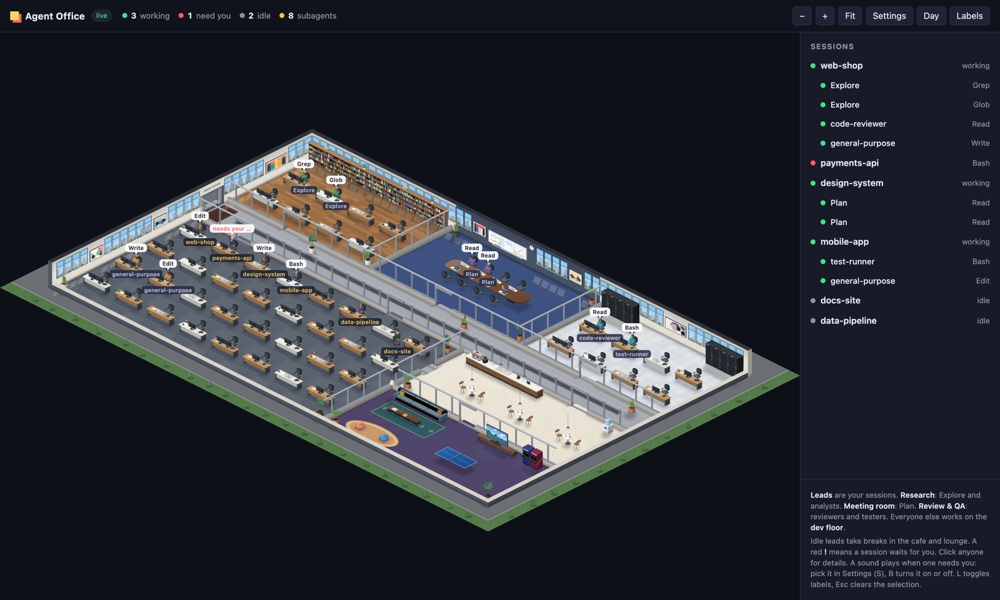
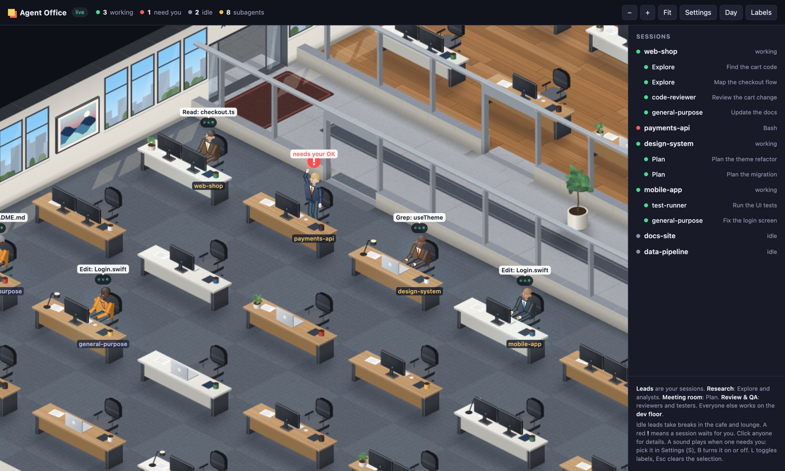
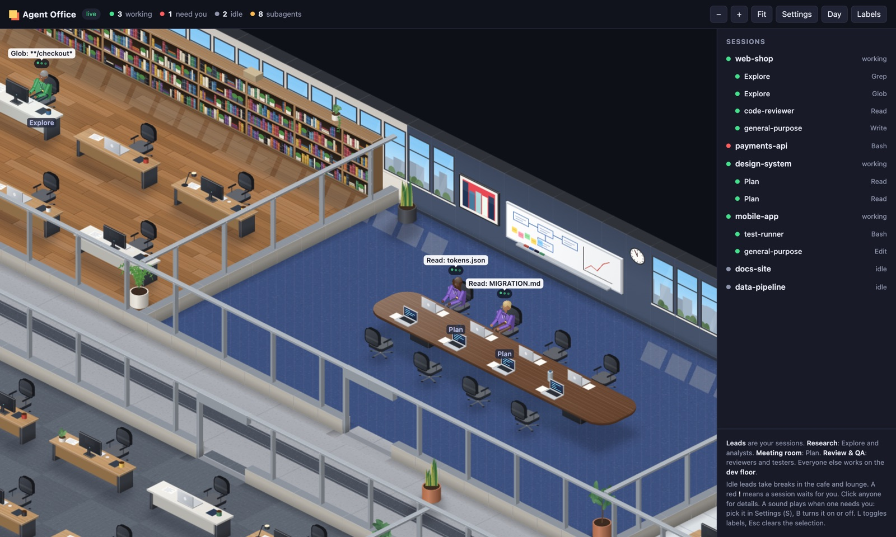
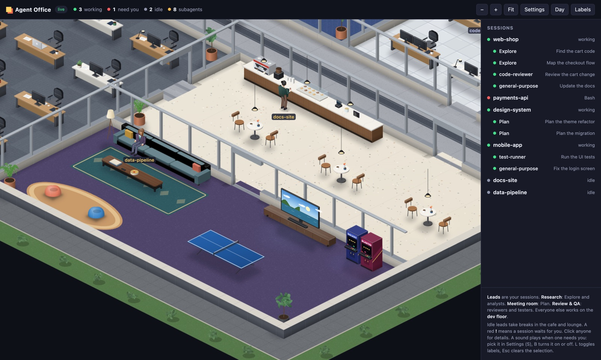
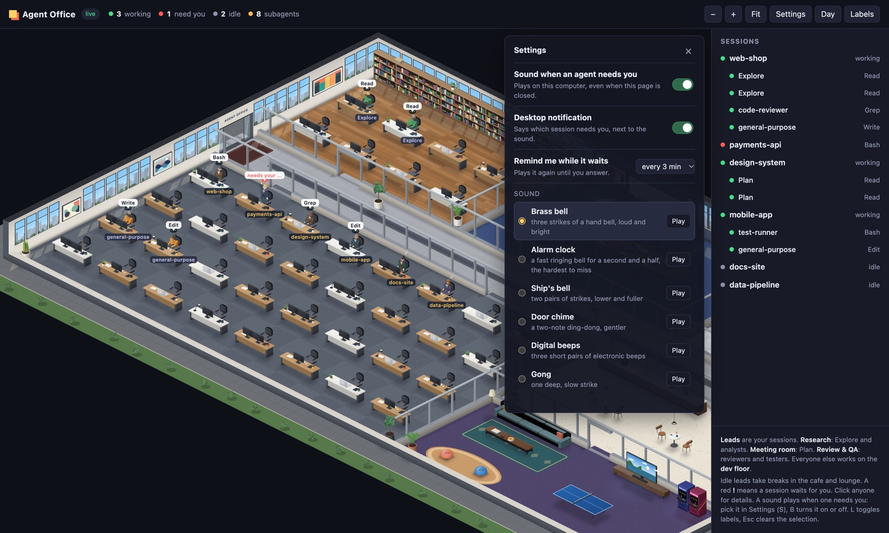
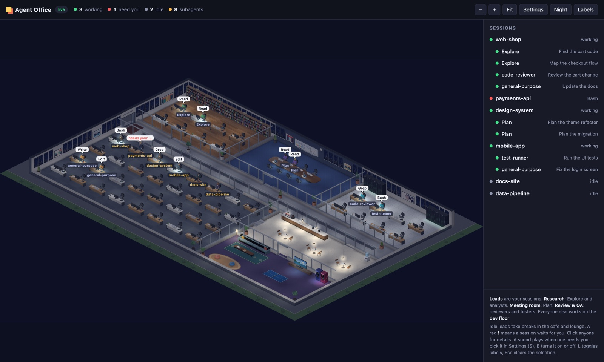

# Agent Office

**A live 3D office of your Claude Code sessions and subagents.** Every session
is a lead at a desk, every subagent a coworker who walks into the room that fits
its job. You see at a glance who is working, who is done, and who is waiting
for you. When one needs you, a sound plays on your computer and a notification
says which one.



- **Runs by itself.** Claude Code hooks start it the first time a session reports
  anything. No extra terminal, no build step.
- **Never misses a question.** Permission prompts, Claude's own questions and
  plan approvals play a sound (six to pick from) and show a desktop notification,
  and remind you again while they wait.
- **Private.** It keeps only event and tool names and short labels, never your
  prompts, code or output, and listens on `127.0.0.1` only.
- **No dependencies.** Plain Node 20+ and a browser. Everything is drawn in code.

## Contents

- [Screenshots](#screenshots)
- [Quick start](#quick-start)
- [How to use it](#how-to-use-it)
- [Commands](#commands)
- [Settings](#settings)
- [How it works](#how-it-works)
- [Privacy and security](#privacy-and-security)
- [Troubleshooting](#troubleshooting)
- [Uninstall](#uninstall)
- [Development](#development)

## Screenshots

| | |
| --- | --- |
|  |  |
| **Your sessions at work.** Speech bubbles show the tool and file; the one waiting for you stands up and waves. | **Rooms by job.** Explore agents in research, Plan agents in the meeting room, reviewers and testers in QA. |
|  |  |
| **Breaks.** Idle sessions get coffee, sit on the sofa, play ping-pong or the arcade. | **Settings.** Sound, notifications, reminders, and a Play button for each sound. |



*At night the windows show the city lights and the office is lit by its lamps
and screens. The light follows your clock, or you can force day or night.*

## Quick start

You need [Node.js](https://nodejs.org) 20 or newer and Claude Code.

```bash
git clone https://github.com/ahmettulutas/agent-office.git
cd agent-office
npm link                  # puts the agent-office command on your PATH
agent-office install      # adds the hooks to ~/.claude/settings.json (backs it up first)
```

That's all. Start `claude` (or a session in the Claude desktop app) and the
office opens at <http://127.0.0.1:47800/>.

No sessions yet? Watch a scripted day at the office:

```bash
agent-office demo
```

Without `npm link`, run every command as `node bin/agent-office.mjs <command>`.

## How to use it

### Reading the office

| what you see | what it means |
| --- | --- |
| A lead in a **blazer and tie** at a desk | one of your sessions |
| A coworker in a **team colour** with a badge | a subagent, in the room for its job |
| A speech bubble (`Edit: Cart.tsx`) | the tool it is running right now |
| Green dots over the head | working |
| **Standing, waving, red `!`** | waiting for you: a permission prompt, a question or a plan to approve |
| Walking to the lead with a paper, then a green check | a subagent finished and hands in its work |
| On the sofa, at the coffee bar, at ping-pong | idle, taking a break |
| `z z z` | idle at the desk for a while |

The rooms:

| room | who works there |
| --- | --- |
| Leads and dev floor | your sessions up front; `general-purpose` and other subagents behind them |
| Research | `Explore`, analysts, web fetch, docs and guide agents |
| Meeting room | `Plan`, orchestrators, architects |
| Review & QA | reviewers, testers, security and audit agents |
| Cafe and lounge | idle sessions on a break |

When a room is full, the rest sit on the dev floor. When every desk is taken,
people work standing in the corridor with a laptop, and take a desk as soon as
one is free.

Click anyone for details: their state, current tool, the last 25 tools with how
long each took, and for a lead a dotted line to each of its subagents. The side
panel lists every session and subagent; click a row to select it.

Zoomed far out, where people are only a few pixels tall, each one gets a pin in
the colour of their state: green working, orange a subagent at work, red waiting
for you (it bounces), grey idle.

### Controls

| | mouse and keyboard | touch screen |
| --- | --- | --- |
| Zoom | wheel, trackpad pinch, `+` / `-`, or the buttons | pinch |
| Zoom in on a spot | double click | double tap |
| Pan | drag | drag with one finger |
| Show the whole office | `0` or **Fit** | **Fit** |
| Select someone | click | tap |
| Follow them | `F` or **Follow** in the details | **Follow** |
| Name tags on or off | `L` or **Labels** | **Labels** |
| Light: auto, day, night | `N` or the light button | the light button |
| Settings | `S` or **Settings** | **Settings** |
| Sound on or off | `B` | in Settings |
| Clear the selection | `Esc` | tap the floor |

### When an agent needs you

A session waits for you when Claude asks for permission, asks you a question,
wants a plan approved, or an MCP tool asks for input. Then:

1. Its lead stands up and waves, with a red `!` and the reason ("needs your OK").
2. The **sound** you picked plays. It plays from the server, so it works with the
   page closed, and several agents asking at once play it once.
3. A **desktop notification** says who and why: "web-shop (Explore) needs your OK".
4. While it keeps waiting, the sound and notification come **again every few
   minutes** (3 by default) until you answer.

Open **Settings** (`S`) to change any of it:

| setting | choices |
| --- | --- |
| Sound when an agent needs you | on or off |
| Desktop notification | on or off |
| Remind me while it waits | never, every 1, 3, 5 or 10 minutes |
| Sound | Brass bell, Alarm clock, Ship's bell, Door chime, Digital beeps, Gong; each has a **Play** button |

## Commands

| command | what it does |
| --- | --- |
| `agent-office install [--yes]` | add the hooks to `~/.claude/settings.json`, after yours; a backup goes to `~/.agent-office/backups/` |
| `agent-office uninstall [--yes]` | remove exactly those hooks (they all end in `# agent-office`) |
| `agent-office open` | open the page, starting the server if needed |
| `agent-office on` / `off` | start it in the background, or stop it |
| `agent-office start [--no-open]` | run the server in this terminal |
| `agent-office status` | running or not, hooks installed or not, which sound |
| `agent-office sound on` / `off` | turn the sound on or off |
| `agent-office sound list` | list the sounds; `*` marks the chosen one |
| `agent-office sound use <name>` | pick a sound: `bell`, `alarm`, `ship`, `chime`, `beeps` or `gong` |
| `agent-office sound test [name]` | play the chosen sound, or another one, now |
| `agent-office demo [--short]` | three made-up sessions and their subagents for about a minute |

## Settings

The page and the terminal save to the same file, `~/.agent-office/config.json`.
Everything is optional:

```json
{
  "port": 47800,
  "openBrowser": "when-closed",
  "forgetAfterHours": 6,
  "bell": true,
  "sound": "bell",
  "notify": true,
  "remindMinutes": 3
}
```

| key | meaning |
| --- | --- |
| `port` | where the office listens; `AGENT_OFFICE_PORT` overrides it |
| `openBrowser` | `when-closed`: open the page when a session starts and none is open (at most every 10 minutes); `on-start`: only when the server starts; `never` |
| `forgetAfterHours` | drop sessions that reported nothing for this long |
| `bell` | play a sound when an agent needs you |
| `sound` | `bell`, `alarm`, `ship`, `chime`, `beeps` or `gong` |
| `notify` | show a desktop notification too |
| `exportEnabled` | `false` by default. `true` adds an "Export trace" button to a session's details (see [Privacy and security](#privacy-and-security)); only the config file can turn it on |
| `metrics` | `false` by default. `true` (or the settings switch) shows an observed token, cache-hit and cost card for the selected session (main session only; see [Privacy and security](#privacy-and-security)) |
| `remindMinutes` | 0, 1, 3, 5 or 10; 0 means no reminders |

`~/.agent-office/` also holds `state.json`, `run.json`, `server.log`, the
synthesised sounds and the settings backups.

## How it works

```
claude ──hook (async)──▶ bin/hook.mjs ──POST /api/event──▶ bin/server.mjs ──SSE──▶ the page
                              │ server down?                  │ state machine (lib/state.mjs)
                              └─▶ starts it in the background  └─▶ ~/.agent-office/state.json
```

- **Hooks**: `SessionStart`, `UserPromptSubmit`, `PreToolUse`, `PostToolUse`,
  `PostToolUseFailure`, `Notification`, `Stop`, `StopFailure`, `SubagentStart`,
  `SubagentStop`, `SessionEnd`. They are `async`, so Claude never waits for them,
  and they always exit 0 without printing anything.
- **States**: a prompt makes a session `busy`, `Stop` makes it `idle`, and
  `SessionEnd` walks it out. A permission or input notification, Claude's own
  question (`AskUserQuestion`) or a plan approval (`ExitPlanMode`) makes it
  `needs-you` until the answer comes back. Sessions that report nothing for 6
  hours are dropped.
- **Esc**: an interrupt fires no hook, but Claude Code writes
  `[Request interrupted by user]` into the session's transcript. The server
  watches the end of a working session's transcript and makes it `idle` within
  about two seconds. If that ever fails, `busy` still falls back to `idle` after
  15 minutes without news.
- **Subagents**: tool events from inside a subagent carry its `agent_id` and
  `agent_type`. Its label is the `description` of the matching `Agent` call.
- **Sounds** are synthesised in code on first use into `~/.agent-office/sounds/`
  and played with `afplay` on macOS, `paplay` or `aplay` on Linux, and
  PowerShell on Windows. **Notifications** use `osascript` on macOS and
  `notify-send` on Linux.
- **The page** is plain canvas 2D: an isometric projection with lit 3D boxes,
  soft shadows from the windows, a light layer for the night, and small 3D
  skeletons for people, so they look right from every side.

## Privacy and security

- The hook keeps only names: the event, the session id, the project folder name,
  the tool name and a short label (a file's base name, a Bash command's
  `description`, a search pattern, a URL's host). It never keeps prompts,
  replies, file contents, full commands or tool output.
- To spot an Esc, the server reads the last 16 KB of a working session's
  transcript, only for files under `~/.claude/projects/`, and only looks for the
  interrupt record. Nothing from the transcript is kept, shown or sent, and the
  page never learns the transcript's path.
- Export is **off by default** (`exportEnabled`). When you turn it on, the
  button builds a TraceExport v1 JSON (`{messages:[{role, content}]}`, the shape
  agent-replay reads) from the session's transcript and hands it to the page as
  a download. Nothing is stored or sent anywhere, and the log only gets counters.
  *Safe* mode drops thinking, reduces tool input to a short label and cuts tool
  results short; *Full* keeps everything. In both, common secret patterns (API
  keys, tokens, `Bearer` headers, URL credentials, private keys, `KEY=value`
  lines) are redacted **on a best-effort basis**: it cannot catch everything, so
  review the file before sharing it. Only `~/.claude/projects/` files are read
  (symlinks resolved), huge transcripts are read from their tail with a size cap,
  and the request must come from the office page itself.
- The token card is **off by default** (`metrics`). When on, it reads only
  counter fields (`usage`, and the last `cost-state`) from the selected
  session's transcript; no prompt or reply text, path or repo name is kept or
  sent, and the log only gets counters. Cost and durations are shown only when
  Claude Code recorded them, otherwise "unknown"; nothing is estimated.
- The server listens on `127.0.0.1` only, refuses other `Host` headers (against
  DNS rebinding), and takes events and settings only as JSON from no origin or
  its own page, so other websites cannot feed it or change your settings.
- Notification text is passed to the system tool as arguments, never inside a
  script, so a project name cannot run anything.
- Nothing leaves your machine.

## Troubleshooting

**I hear nothing.** Run `agent-office sound test`. If that is silent, turn the
system volume up (the sounds are at full volume already). If that plays but
agents don't, check that the sound is on: `agent-office status`.

**No desktop notifications on macOS.** They come from Script Editor. Allow
Script Editor in System Settings, Notifications, then try a prompt again.

**The page didn't open.** Run `agent-office open`. The page opens by itself only
when a session starts and no page is open, at most every 10 minutes.

**A session stays "working" after it stopped.** Pressing Esc is caught from the
transcript within seconds; anything else falls back to idle after 15 minutes.
Sending the next prompt fixes it right away.

**Port 47800 is in use.** Set another one, for example `{"port": 47900}` in
`~/.agent-office/config.json`, then run `agent-office off` and
`agent-office open`.

**See what the server did.** Look in `~/.agent-office/server.log`.

## Uninstall

```bash
agent-office uninstall    # removes only the hooks it added
agent-office off
npm unlink -g agent-office
rm -rf ~/.agent-office    # state, settings, sounds, backups
```

## Development

```bash
npm test
```

That runs 24 tests: the state machine and privacy filter, the floor plan and
paths, the 3D draw order, the sounds, and a real server in a temporary home
with sound and notifications muted (host and origin checks, settings, sound,
notifications, reminders, Esc). Edit a file in `web/` and reload the page: the
server reads it on every request.

| path | what it holds |
| --- | --- |
| `bin/agent-office.mjs` | the command line |
| `bin/hook.mjs` | the hook Claude Code runs; starts the server when needed |
| `bin/server.mjs` | the HTTP server, live stream, sound, notifications, reminders |
| `lib/state.mjs` | the state machine: sessions, subagents, who waits for you |
| `lib/extract.mjs` | turns a hook payload into a small, privacy-safe event |
| `lib/sounds.mjs`, `lib/notify.mjs` | the sounds and the desktop notifications |
| `lib/transcript.mjs` | spotting an Esc in a transcript |
| `web/app.js` | the page's frame loop and live data |
| `web/office.js` | what people do: seats, breaks, hand-offs, walking |
| `web/render.js` | drawing a frame: layers, light, pins, labels |
| `web/camera.js`, `web/input.js` | zoom and pan; mouse, touch and keys |
| `web/panel.js`, `web/settings.js` | the side panel and the settings panel |
| `web/map.js` | the floor plan and path finding |
| `web/iso.js`, `web/scene.js`, `web/furniture.js` | the 3D projection, walls and glass, and every piece of furniture |
| `web/people.js`, `web/look.js` | people and how each one looks |
| `web/floors.js` | floors, rugs and the time of day |

## Credits

Ideas from [clalt](https://github.com/dhitalkamal/clalt) (MIT): the hook-fed
state machine, a room per agent type and the paper hand-off. Also from
[office-for-claude-agents](https://github.com/percheniy/office-for-claude-agents):
the office and the idle activities. No code or art was copied: everything is
drawn in code.

## License

[MIT](LICENSE)
